import AffiliateCard from '@/components/AffiliateCard.astro';
import RestaurantInfoCard from '@/components/RestaurantInfoCard.astro';

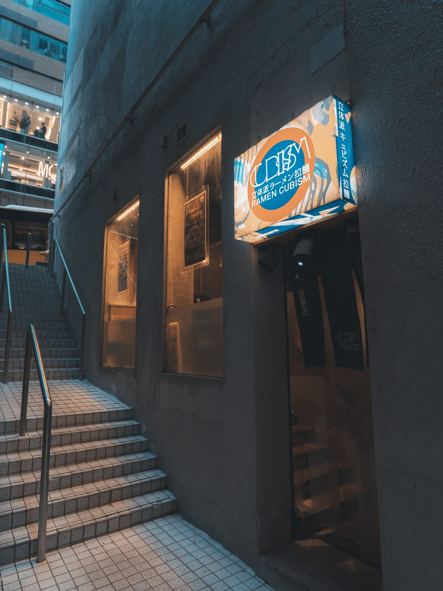

If you're hunting for a soul-stirring bowl of ramen amidst the bustling streets of Central, the basement of Wellington Street hides a name you absolutely cannot miss: **Ramen Cubism**. Inspired by the Cubist art movement pioneered by Pablo Picasso, the restaurant has been surprising Hong Kong's food scene with its house-made noodles and premium Japanese ingredients since opening its doors in 2019.

This autumn, celebrating the 10th anniversary of the brand's mastermind—Japanese champion ramen chef **Takao Hayashi**—the restaurant has launched two highly anticipated seasonal creations. These aren't just bowls of ramen; they are a culinary showcase merging extreme creativity with Osaka's authentic artisan spirit.

---

## Champion Chef Takao Hayashi: A Creative Obsession Beyond the Bowl

Before diving into the new menu, we need to introduce the artisan standing at the pinnacle of the ramen world. Hailing from Osaka, Takao Hayashi is renowned for his exquisite craftsmanship and agile creativity. His meticulous pursuit of broths, noodles, and toppings has seen him sweep through Japan's ramen scene over the past decade.

Starting with the "Ultimate Ramen Kansai New Shop Grand Prize" in 2016, Chef Hayashi went on to win the national championship at the **"Yahoo! Next Generation Ramen Championship"** in 2018. His establishment in Osaka, "Creative Ramen Style Hayashi," draws endless crowds and has been consecutively awarded the **Tabelog "Ramen 100 Famous Stores" OSAKA award (2023-2024)**, while also taking the #1 spot on Tripadvisor's Kyoto restaurant rankings (2025-2026). The new creations debuting at Hong Kong's Ramen Cubism are the crystallization of his ten years of dedication to the craft.

---

## Chapter One: A Masterpiece Born from a Two-Hour Challenge — Black Sesame & Autumn Mushroom Rich Foam Chicken Broth Ramen

The birth of this ramen is a legend in itself. It originated from a special project on a Japanese television show: Chef Hayashi was challenged to use wild mushrooms harvested that very day—ingredients completely unknown to him beforehand—to improvise a brand-new ramen dish within a strict two-hour limit. The result won unanimous praise in the studio, and now, he has brought this incredible Hong Kong interpretation to our tables ($188 HKD).

### 🔪 The Artisan's Touch: Masterful Heat and Whipping Techniques

The preparation in the kitchen is like a precise chemistry experiment. The chef blends an ultra-rich chicken broth with a seafood-salt tare, using a hand blender to whip up a fine, dense foam. The treatment of the toppings is just as meticulous: mushrooms are crowned with cheese and fiercely blow-torched to coax out a rich, charred aroma.

{/* Horizontal Scroll Gallery - Foam Chicken Broth Preparation */}

  <figure class="snap-center shrink-0 w-[85%] sm:w-80 m-0 flex flex-col">
    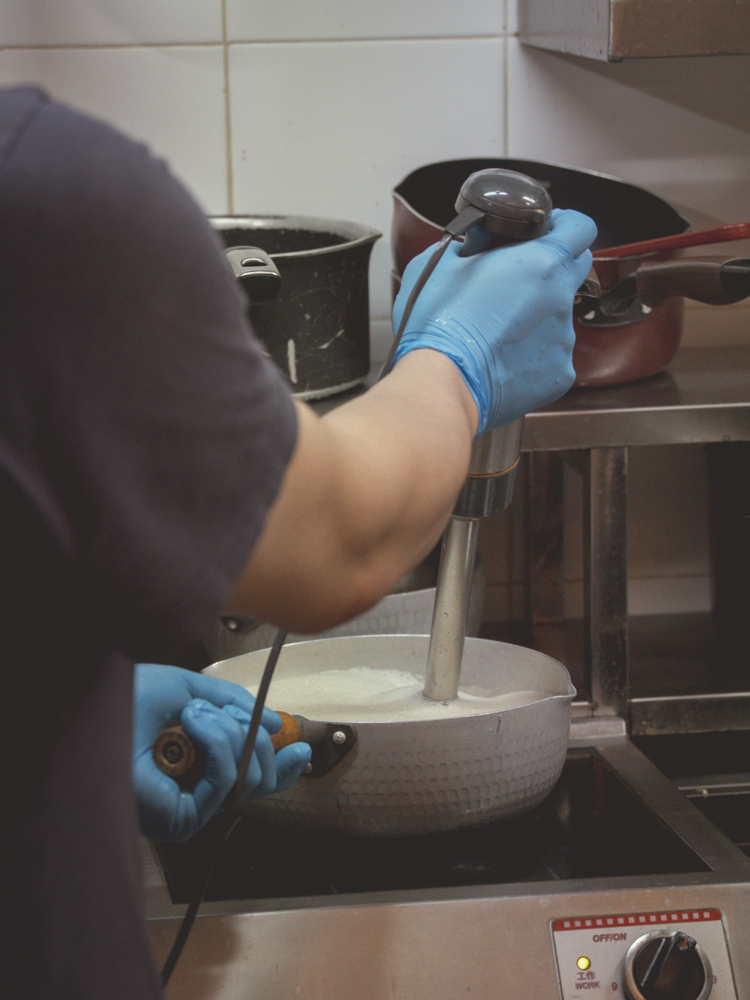
    <figcaption class="text-center text-sm text-muted-foreground mt-3 italic">Whipping the rich chicken broth into a dense foam for a silky texture</figcaption>
  </figure>
  <figure class="snap-center shrink-0 w-[85%] sm:w-80 m-0 flex flex-col">
    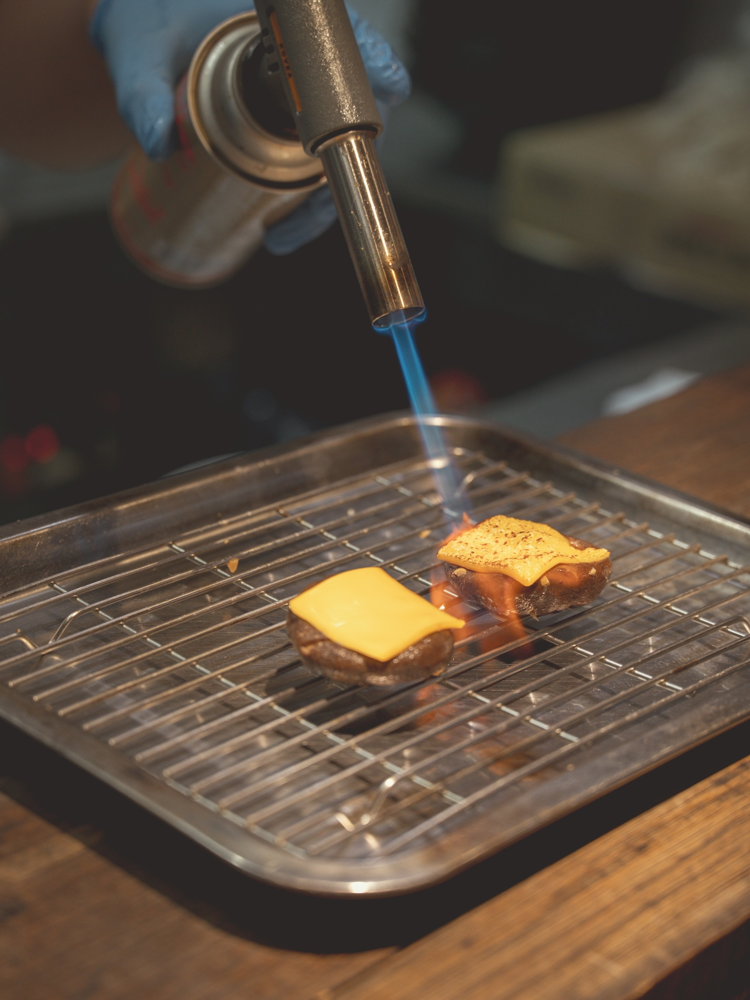
    <figcaption class="text-center text-sm text-muted-foreground mt-3 italic">Fiercely torching the cheese-topped mushrooms to bring out a tempting charred aroma</figcaption>
  </figure>

### 🍜 Tasting Guide: A Flavor Journey from Fresh to Mellow

When savoring this artful bowl, I highly recommend **taking your first sip of the pure, foamy chicken broth** to experience the delicate balance of its umami sweetness and the slight tartness of the pickled *Agaricus blazei* mushrooms. Then, **slowly mix the central scoop of black sesame cream into the soup**. The broth is instantly imbued with a rich, roasted profile. Combined with the savory roasted mushrooms, crispy fried enoki mushrooms, and refreshing yuzu chicken, every bite offers a completely different landscape of flavors.

{/* Horizontal Scroll Gallery - First Ramen Close-ups */}

  <figure class="snap-center shrink-0 w-[85%] sm:w-80 m-0 flex flex-col">
    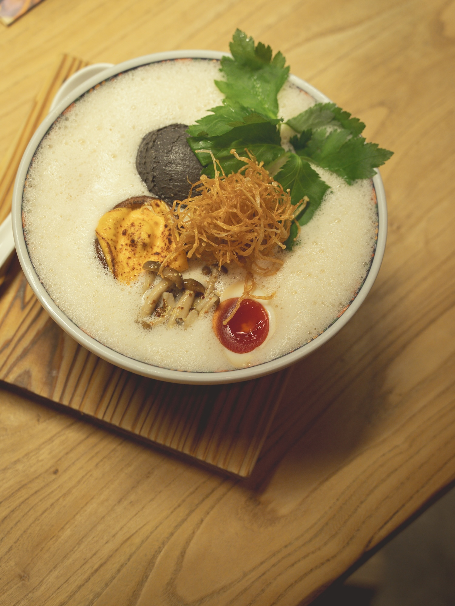
    <figcaption class="text-center text-sm text-muted-foreground mt-3 italic">A rich layering of black sesame, autumn mushrooms, and foam chicken broth</figcaption>
  </figure>
  <figure class="snap-center shrink-0 w-[85%] sm:w-80 m-0 flex flex-col">
    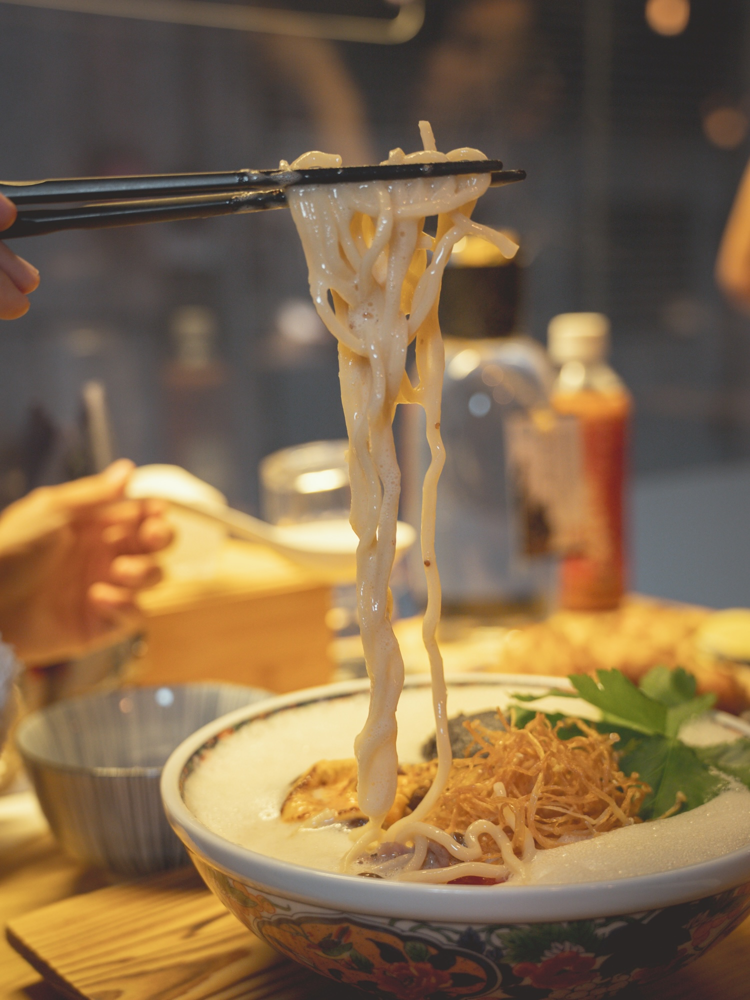
    <figcaption class="text-center text-sm text-muted-foreground mt-3 italic">The noodles cling tightly to the rich black sesame foam broth</figcaption>
  </figure>

{/* Affiliate 1: Central Attractions (Klook) */}
<AffiliateCard 
  type="klook"
  title="Central Half-Day Itinerary: 6th Generation Peak Tram Tickets" 
  description="After a satisfying meal, taking a stroll around Central is the perfect follow-up! Just a short walk from the restaurant, you can hop on the newly upgraded 6th Generation Peak Tram. Book fast-track, skip-the-line tickets via Klook to easily take in the breathtaking sunset and night views of Victoria Harbour." 
  link="https://www.klook.com/en-US/placeholder-peak-tram" 
  buttonText="Check Klook Exclusive Ticket Offers" 
/>

---

## Chapter Two: The Craze from Osaka — Triple Meat & Onsen Egg Ramen

If the first bowl is an elegant piece of art, this signature meat-lovers' ramen—which has been massively popular since its launch at Osaka's "Men Style Hayashi" main store in early 2026—is the ultimate holy grail for carnivores ($178 HKD).

### 🔥 A Dual Explosion of Sight and Scent: Fierce Blow-Torching

The preparation of this bowl is full of wild tension. The chef uses a powerful blowtorch directly on an iron pan to sear Japanese beef intestines, instantly transforming the fat under high heat into an irresistibly tempting charred aroma. Subsequently, generous spoonfuls of a rich pork sauce—blended from several types of Japanese red miso—are dolloped onto a refined fish and soy sauce broth.

{/* Horizontal Scroll Gallery - Triple Meat Preparation */}

  <figure class="snap-center shrink-0 w-[85%] sm:w-80 m-0 flex flex-col">
    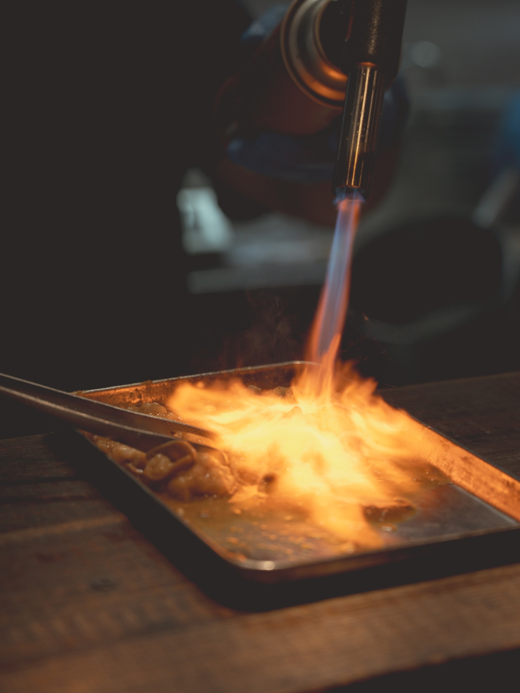
    <figcaption class="text-center text-sm text-muted-foreground mt-3 italic">Fiercely torching Japanese beef intestines to render out the ultimate savory fat</figcaption>
  </figure>
  <figure class="snap-center shrink-0 w-[85%] sm:w-80 m-0 flex flex-col">
    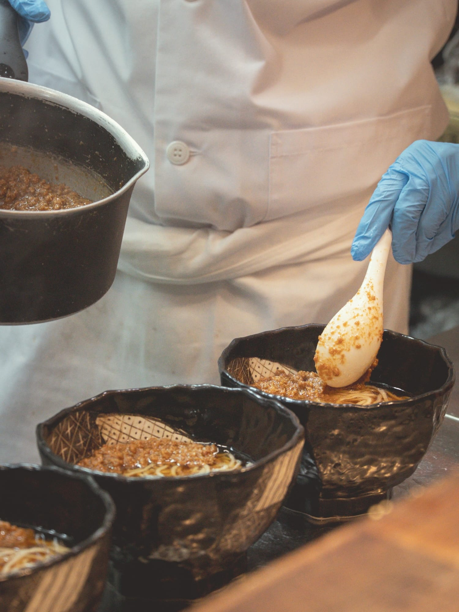
    <figcaption class="text-center text-sm text-muted-foreground mt-3 italic">Dolloping on a mellow pork sauce blended with multiple Japanese red misos</figcaption>
  </figure>

### 🥩 The Ultimate Indulgence: Breaking the Onsen Egg

This ramen unites fruity-glazed pork belly slices, a rich red miso pork sauce, and savory charred beef intestines. **The absolute stroke of genius is breaking the double-yolk onsen egg right in the center.** The thick egg yolk blends perfectly, transforming the intensely savory flavors into an incredibly smooth and mellow texture. When you lift the noodles, the decadent sauce clings tightly to them—pure satisfaction.

{/* Horizontal Scroll Gallery - Second Ramen Close-ups */}

  <figure class="snap-center shrink-0 w-[85%] sm:w-80 m-0 flex flex-col">
    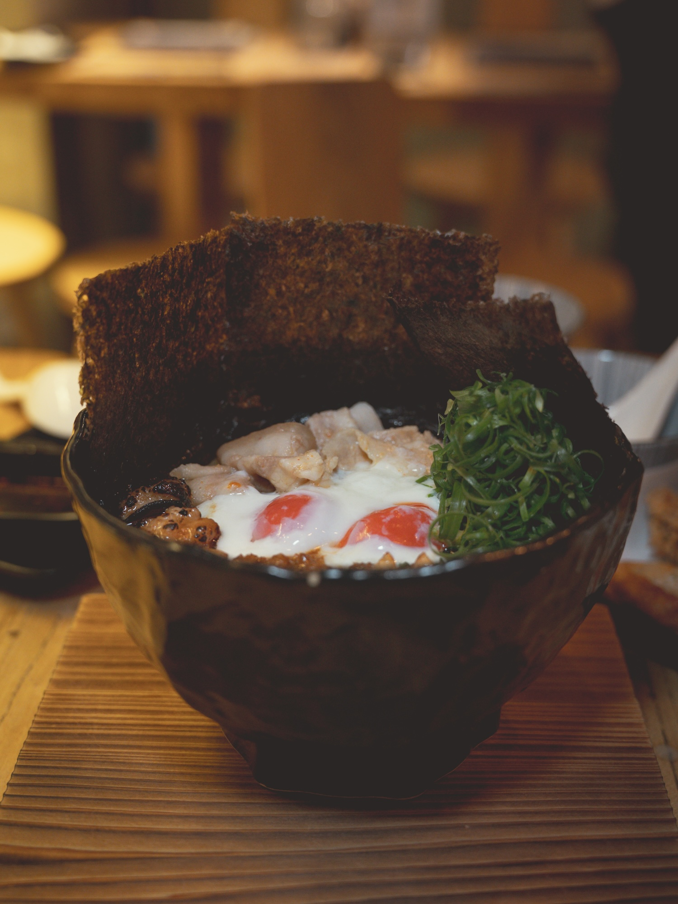
    <figcaption class="text-center text-sm text-muted-foreground mt-3 italic">Triple Meat & Onsen Egg Ramen, brimming with savory meat aromas</figcaption>
  </figure>
  <figure class="snap-center shrink-0 w-[85%] sm:w-80 m-0 flex flex-col">
    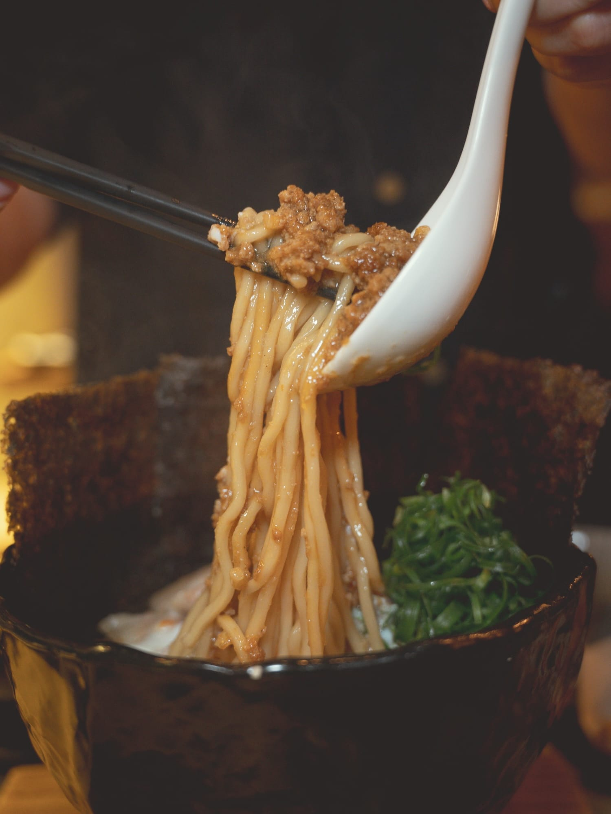
    <figcaption class="text-center text-sm text-muted-foreground mt-3 italic">Break the onsen egg and mix; the noodles get beautifully coated in a smooth, mellow meat sauce</figcaption>
  </figure>

{/* Affiliate 2: eSIM for Tourists (KKday) */}
<AffiliateCard 
  type="kkday"
  title="Must-Have for Travelers: Hong Kong 4G/5G Unlimited Data eSIM" 
  description="Want to instantly share this incredibly indulgent Triple Meat Ramen on IG? For overseas travelers, we highly recommend this Hong Kong unlimited data eSIM. Buy and use instantly without swapping cards, ensuring a stable connection to upload high-res food photos anytime, anywhere!" 
  link="https://www.kkday.com/en-US/placeholder-esim-hk" 
  buttonText="Check KKday eSIM Offers Now" 
/>

---

## Epilogue: A Perfect Finale in a Cubist Space

At Ramen Cubism, the brilliance doesn't stop at the ramen. The restaurant offers a variety of high-quality sides: Nagoya-style fried chicken wings sprinkled with shichimi pepper and sesame, and pan-fried Japanese gyoza that are perfectly golden and crispy. Paired with a refreshing "Mt. Fuji Yuzu Cider," it’s the most beautiful conclusion to a meal.

{/* Horizontal Scroll Gallery - Sides and Drinks */}

  <figure class="snap-center shrink-0 w-[85%] sm:w-80 m-0 flex flex-col">
    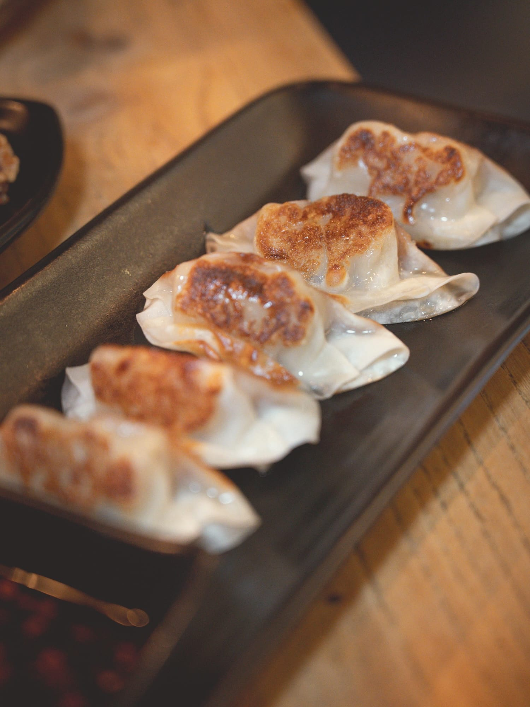
    <figcaption class="text-center text-sm text-muted-foreground mt-3 italic">Golden, crispy pan-fried Japanese gyoza</figcaption>
  </figure>
  <figure class="snap-center shrink-0 w-[85%] sm:w-80 m-0 flex flex-col">
    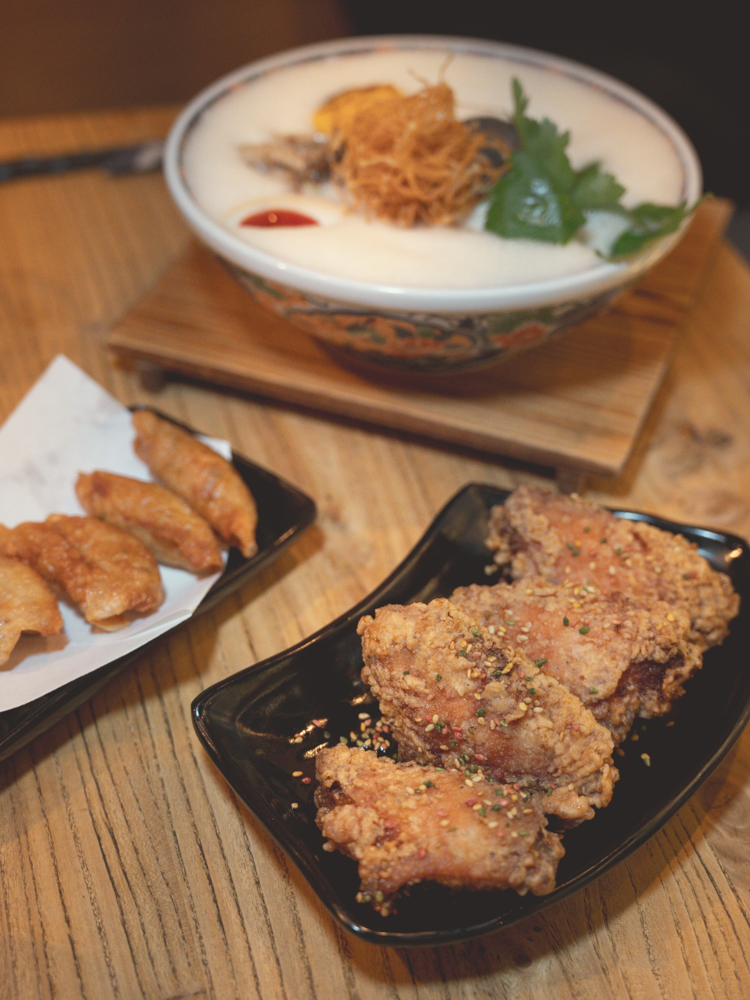
    <figcaption class="text-center text-sm text-muted-foreground mt-3 italic">Savory Nagoya-style fried chicken wings sprinkled with shichimi and sesame</figcaption>
  </figure>
  <figure class="snap-center shrink-0 w-[85%] sm:w-80 m-0 flex flex-col">
    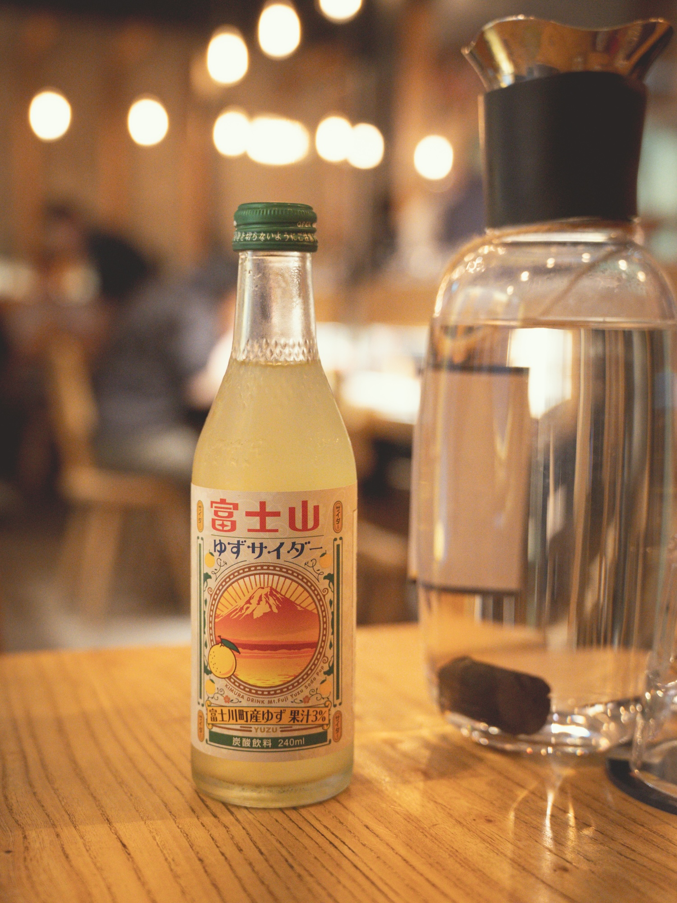
    <figcaption class="text-center text-sm text-muted-foreground mt-3 italic">Refreshing Yuzu Cider straight from Fujikawa Town</figcaption>
  </figure>

The 1,200-square-foot dining space uses extensive raw wood materials paired with warm Edison bulb pendant lights, creating an inviting and relaxing atmosphere that feels like home. With visually striking Cubist paintings hanging on the walls, savoring the craftsmanship of a champion artisan in this environment is undoubtedly the most worthwhile culinary experience you can have this autumn.

{/* Horizontal Scroll Gallery - Restaurant Environment */}

  <figure class="snap-center shrink-0 w-[85%] sm:w-80 m-0 flex flex-col">
    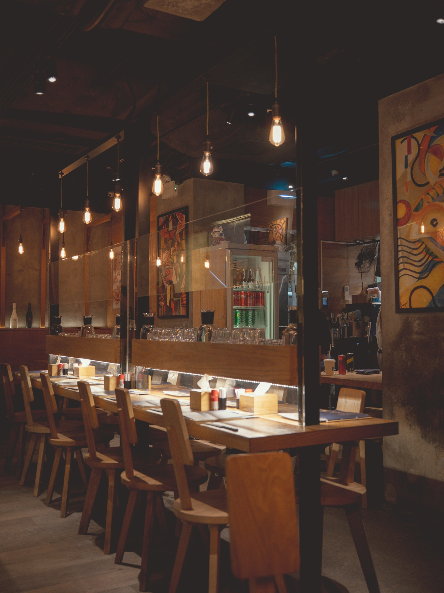
    <figcaption class="text-center text-sm text-muted-foreground mt-3 italic">Artistic Cubist paintings alongside a warm wooden bar</figcaption>
  </figure>
  <figure class="snap-center shrink-0 w-[85%] sm:w-80 m-0 flex flex-col">
    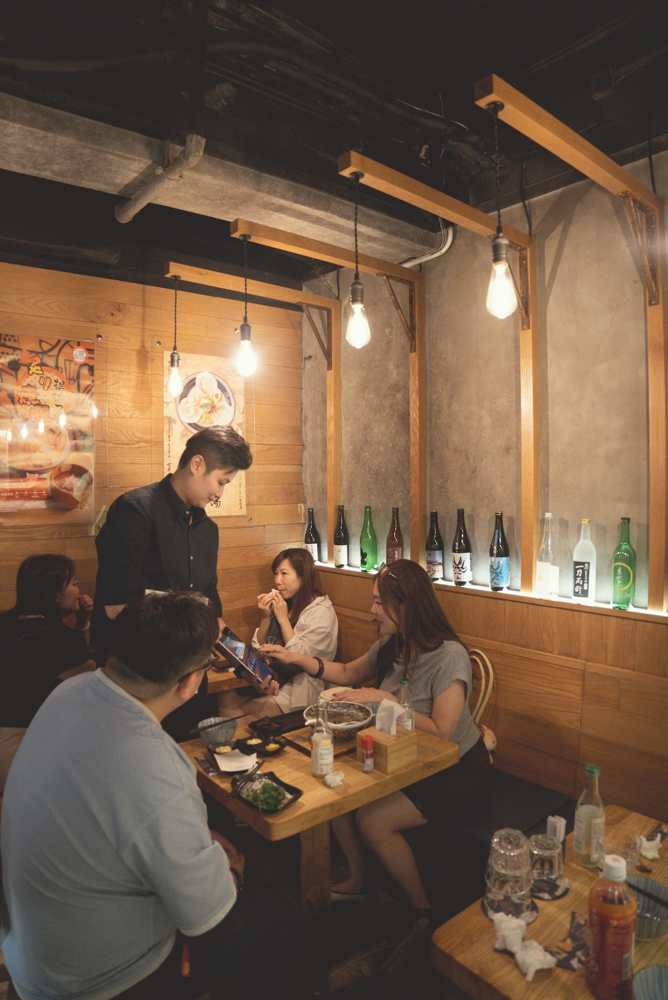
    <figcaption class="text-center text-sm text-muted-foreground mt-3 italic">Cozy booth seating and a curated sake display</figcaption>
  </figure>
  <figure class="snap-center shrink-0 w-[85%] sm:w-80 m-0 flex flex-col">
    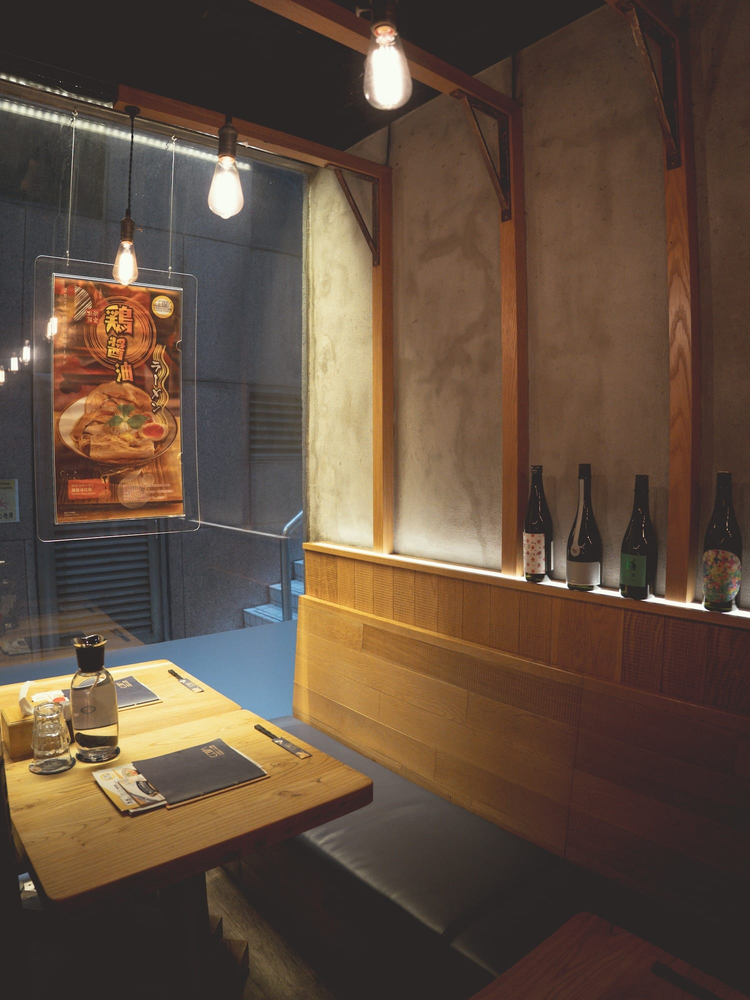
    <figcaption class="text-center text-sm text-muted-foreground mt-3 italic">Glass window seating bathed in natural light, offering a tranquil dining environment</figcaption>
  </figure>

{/* Affiliate 3: High-Quality Central Hotel Staycation (Agoda) */}
<AffiliateCard 
  type="agoda"
  title="The Ultimate Central Stay Experience: The Murray" 
  description="Planning the perfect weekend staycation? Just steps away from Lan Kwai Fong and Central's dining district, The Murray is renowned for its iconic archways and luxurious spaces. After enjoying the ultimate ramen at Cubism, retreat to the hotel to continue your exclusive, relaxing evening." 
  link="https://www.agoda.com/en-US/placeholder-the-murray" 
  buttonText="Check Latest Agoda Rates & Offers" 
/>

<RestaurantInfoCard 
  name="Ramen Cubism"
  address="Basement, Yuen Yick Building, 27-29 Wellington Street, Central, Hong Kong"
  hours="Monday to Sunday 11:00 AM - 11:00 PM"
  phone="(852) 2399-0811"
  website="www.ramencubism.com"
  igLink="https://www.instagram.com/ramencubism/"
  igHandle="@ramencubism"
/>