import AffiliateCard from '@/components/AffiliateCard.astro';
import RestaurantInfoCard from '@/components/RestaurantInfoCard.astro';

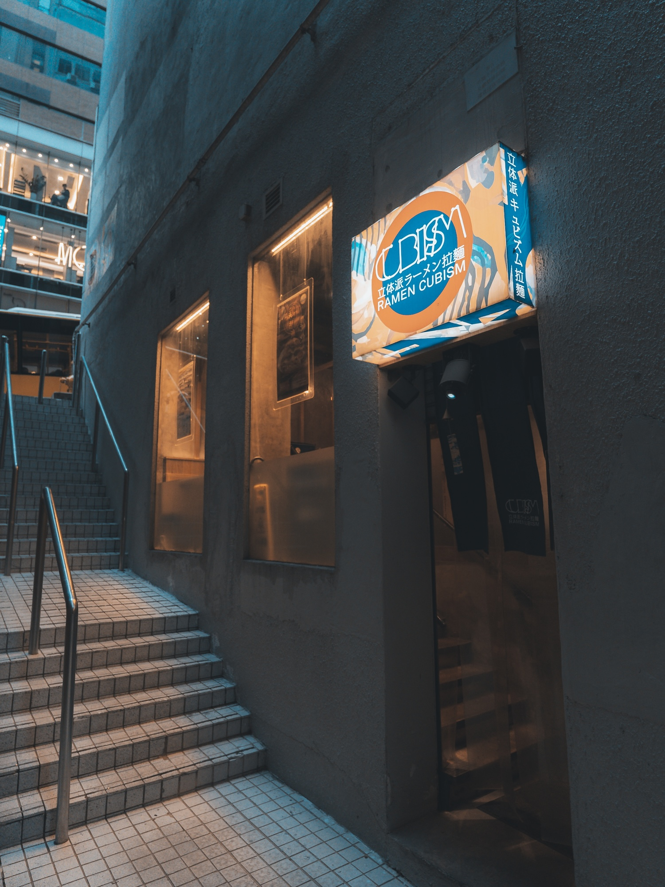

要在中環繁華的街道中尋找一碗令人靈魂震顫的拉麵，威靈頓街地庫的 **「立体派 Ramen Cubism」** 絕對是不可錯過的名字。餐廳命名靈感源自 20 世紀藝術巨匠畢加索的立體派風格，自 2019 年開業以來，一直以自家製麵條與東瀛優質食材，為香港食客帶來突破傳統的驚喜。

今年秋天，適逢品牌靈魂人物——日本冠軍級拉麵大師**林隆臣**入行 10 周年，餐廳推出了兩款極具話題性的秋日限定新作。這不僅是兩碗拉麵，更是一場結合了極限創意與大阪職人精神的味覺展覽。

---

## 冠軍大師 林隆臣 (Takao Hayashi)：不止於一碗拉麵的創作狂熱

在品嚐新作之前，我們必須先認識這位站在拉麵界頂端的職人。來自日本大阪的林隆臣，以精湛的工藝與靈活的創意聞名。他對湯底、麵條與配料的細緻追求，讓他在過去十年間橫掃日本拉麵界。

從 2016 年奪得「終極拉麵關西新店大獎」起步，林師傅在 2018 年一舉拿下 **「Yahoo! 次世代拉麵選手權」全國冠軍**。他在大阪塚本站創立的「創作らーめん Style林」吸引無數食客慕名前往，更連續多年入選 **Tabelog「拉麵百名店」OSAKA 獎 (2023-2024)**，並在 Tripadvisor 榮登京都餐廳口碑排行榜第一名 (2025-2026)。這次在香港「立体派」推出的新作，正是他十年匠心淬鍊的結晶。

---

## 第一章：兩小時極限誕生的神作 —— 黑芝麻秋菌濃厚泡沫雞白湯拉麵

這碗麵的誕生過程本身就是一個傳奇。它源自日本電視台節目的特別企劃：林大師獲邀接受挑戰，必須使用當日剛從山上採集、事前完全未知的野生菇菌，在 2 小時內即興創作出一碗全新拉麵。結果這碗麵獲得一致好評，如今他將這個香港演繹版帶到了我們面前 ($188)。

### 🔪 職人視角：極致的火候與打發

廚房內的製作過程猶如一場精密的化學實驗。師傅以極濃雞白湯融合海鮮鹽味醬汁，利用攪拌棒打製出細緻綿密的泡沫。配料的處理更是講究，香菇放上芝士後以火槍猛烈炙燒，逼出濃郁焦香。

{/* 橫向滑動圖片庫 - 泡沫雞白湯製作過程 */}

  <figure class="snap-center shrink-0 w-[85%] sm:w-80 m-0 flex flex-col">
    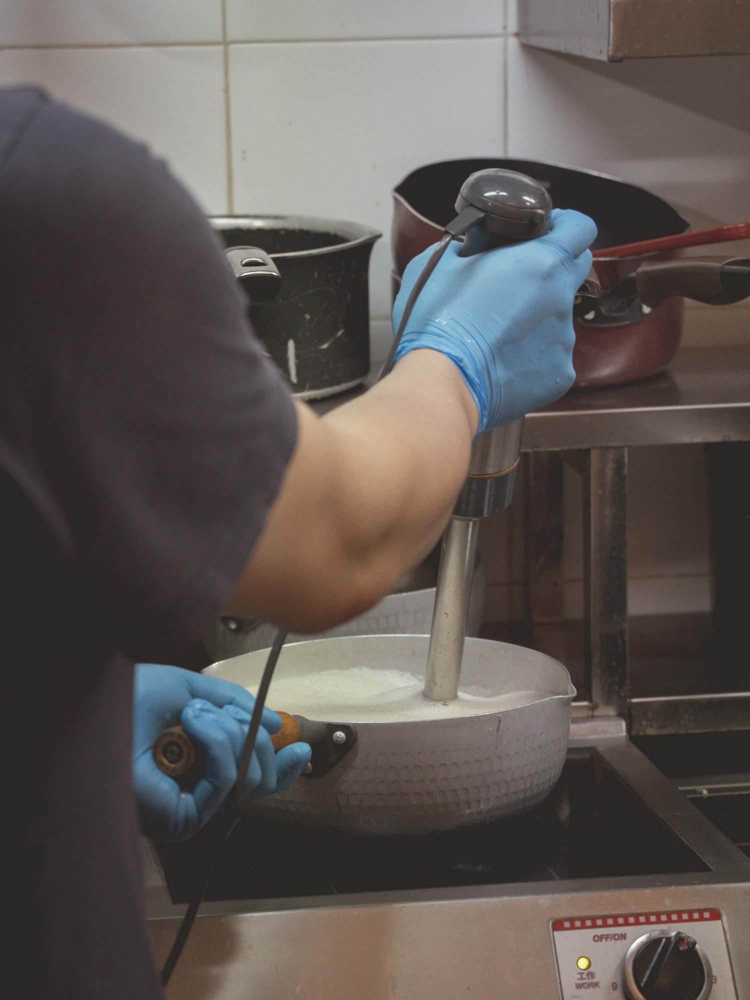
    <figcaption class="text-center text-sm text-muted-foreground mt-3 italic">用攪拌棒將濃郁雞白湯打出綿密泡沫，口感如絲般柔滑</figcaption>
  </figure>
  <figure class="snap-center shrink-0 w-[85%] sm:w-80 m-0 flex flex-col">
    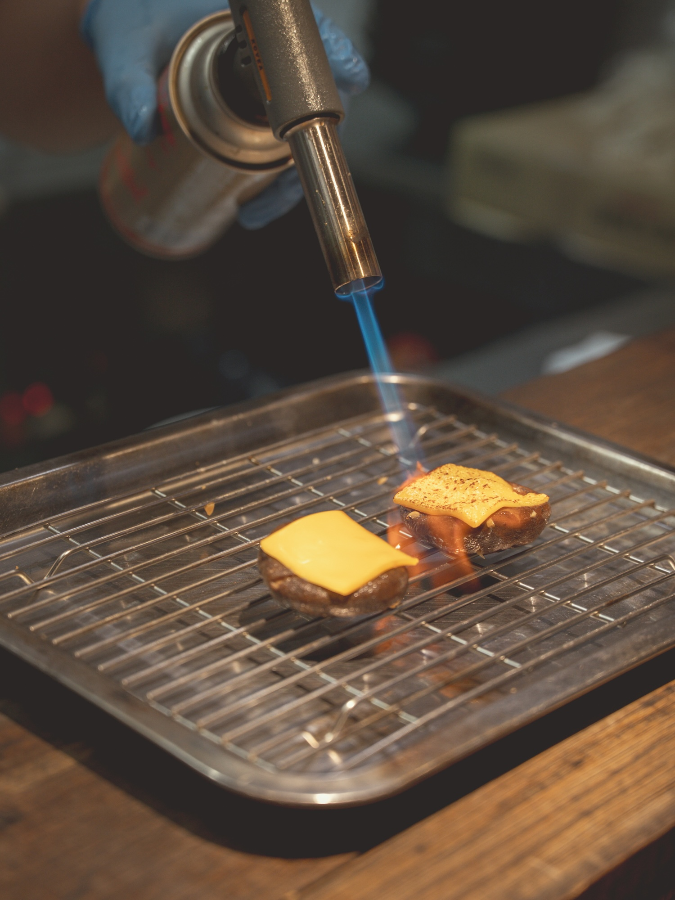
    <figcaption class="text-center text-sm text-muted-foreground mt-3 italic">高溫炙燒芝士香菇，帶出誘人焦香</figcaption>
  </figure>

### 🍜 品味指南：從清新到醇厚的味覺轉換

品嚐這碗充滿藝術感的拉麵，強烈建議**先喝一口純粹的泡沫雞白湯**，感受那份鮮甜與微酸醋漬姬松茸的奇妙平衡。接著，**慢慢將中間的黑芝麻忌廉醬拌入湯中**，湯頭瞬間被賦予了濃郁的烘香。配合鹹香的烤香菇、香脆的炸金針菇，以及清新的柚子雞肉，每一口都是截然不同的風景。

  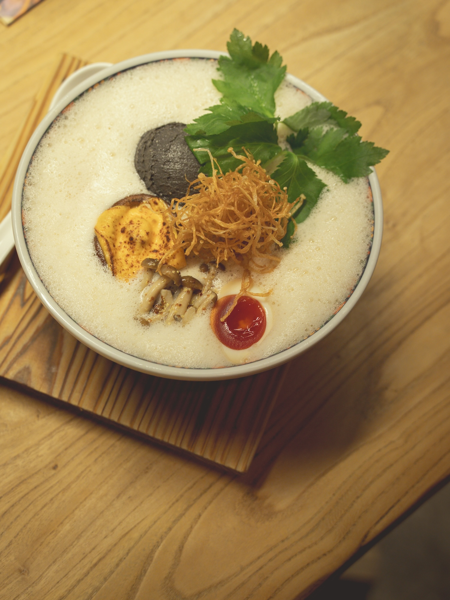
  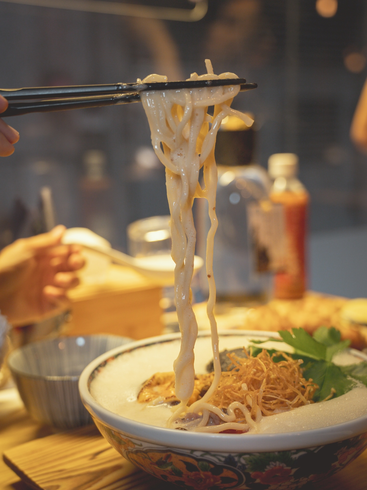

{/* Affiliate 1: 中環周邊景點 (Klook) */}
<AffiliateCard 
  type="klook"
  title="中環半日遊推薦：第六代山頂纜車優惠門票" 
  description="吃飽喝足後，最適合在中環附近散步！距離餐廳步程不遠，即可搭乘全新升級的第六代山頂纜車。透過 Klook 預訂免排隊快速通關，輕鬆飽覽維港絕美日落與夜景。" 
  link="https://www.klook.com/zh-HK/placeholder-peak-tram" 
  buttonText="查看 Klook 專屬門票優惠" 
/>

---

## 第二章：來自大阪的狂熱 —— 三重肉盛・溫泉蛋拉麵

如果說第一款麵是優雅的藝術品，那麼這款自 2026 年初在大阪「麺スタイル林・総本店」推出便大受歡迎的招牌肉拉麵，絕對是給「食肉獸」的最強福音 ($178)。

### 🔥 視覺與嗅覺的雙重爆發：猛火炙燒

這碗麵的製作過程充滿野性張力。廚師使用猛烈的火槍直接在鐵盤上炙燒日本產牛腸，油脂在高溫下瞬間轉化為極具誘惑力的焦香。隨後在清雅的魚介醬油湯底中，大匙鋪上融合多款日本赤味噌調製的醇厚豚肉醬。

{/* 橫向滑動圖片庫 - 三重肉盛製作過程 */}

  <figure class="snap-center shrink-0 w-[85%] sm:w-80 m-0 flex flex-col">
    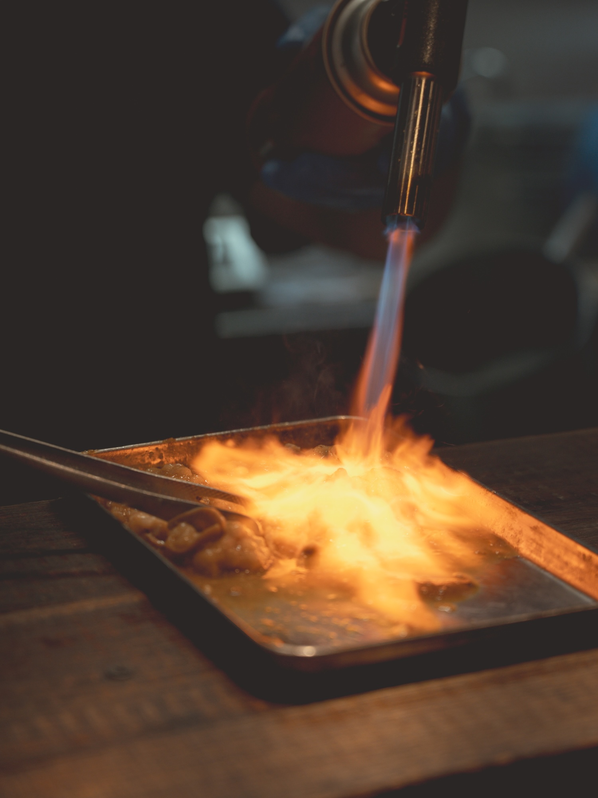
    <figcaption class="text-center text-sm text-muted-foreground mt-3 italic">猛火炙燒日本產牛腸，逼出極致油脂</figcaption>
  </figure>
  <figure class="snap-center shrink-0 w-[85%] sm:w-80 m-0 flex flex-col">
    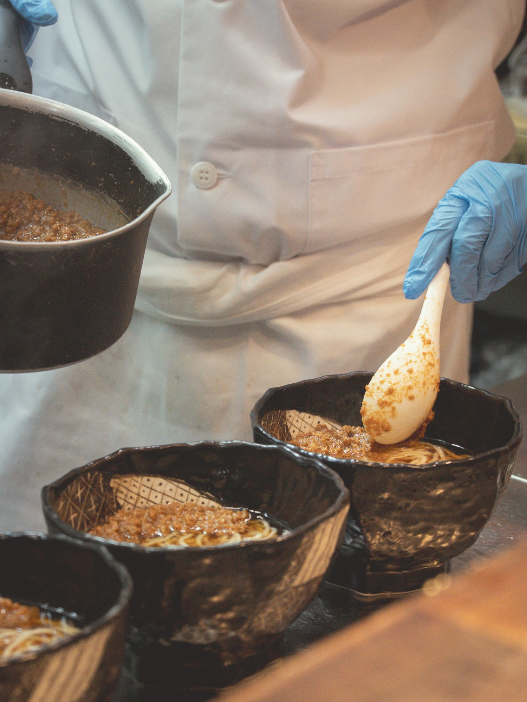
    <figcaption class="text-center text-sm text-muted-foreground mt-3 italic">鋪上融合多款日本赤味噌的醇厚豚肉醬</figcaption>
  </figure>

### 🥩 邪惡的極致：拌入溫泉蛋的瞬間

這碗拉麵集結了帶有果香的豚肉腩片、濃郁赤味噌豚肉醬，以及惹味焦香的炙燒牛腸。**最神來之筆的吃法，莫過於將正中央的雙黃溫泉蛋戳破。** 濃稠的蛋液完美交融，將原本強烈的鹹香轉化為極度柔滑圓潤的口感。夾起麵條時，醬汁緊緊掛在麵上，超級滿足。

  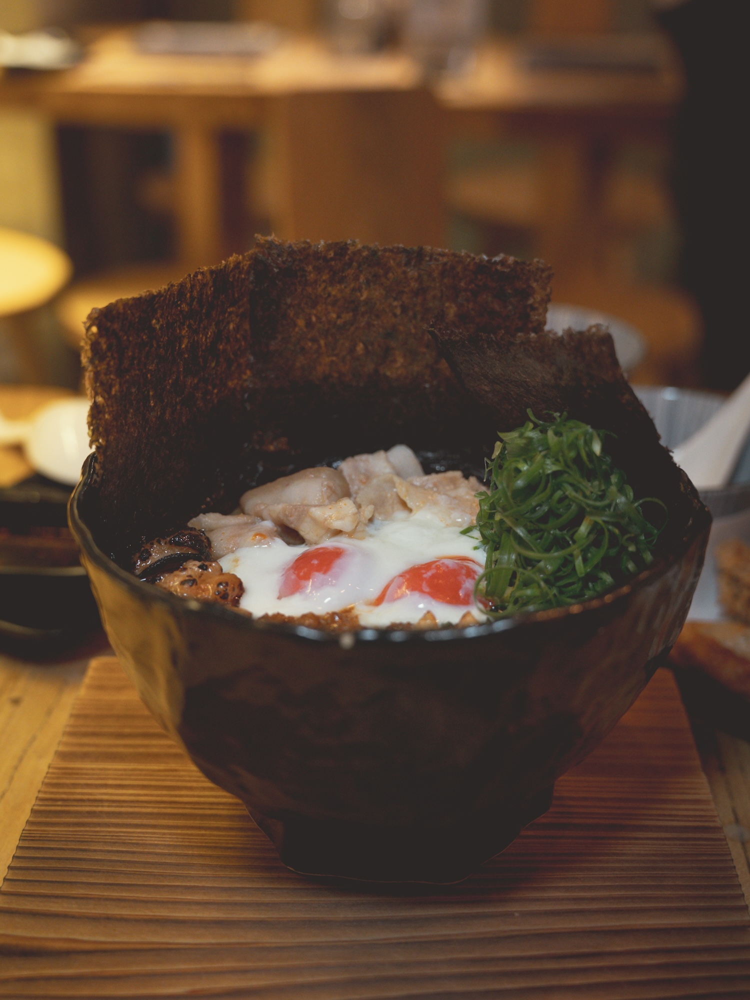
  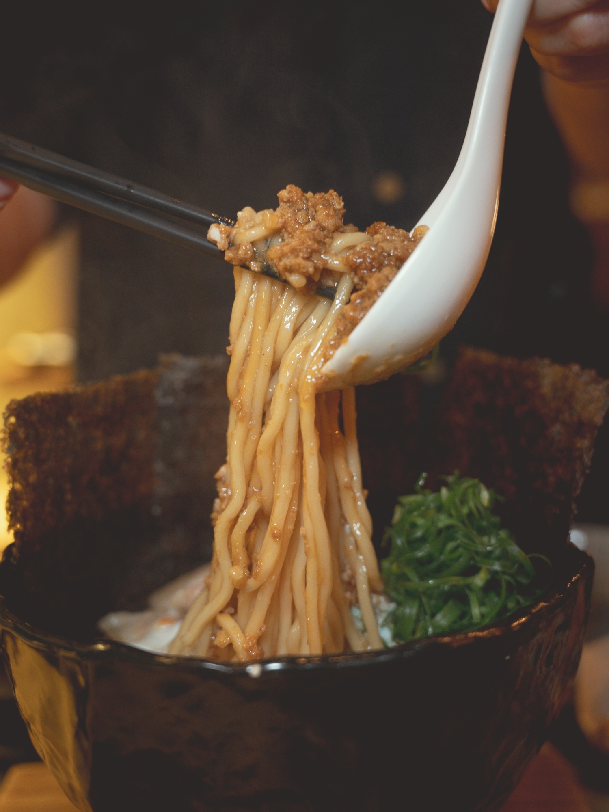

{/* Affiliate 2: 海外旅客必備 eSIM (KKday) */}
<AffiliateCard 
  type="kkday"
  title="遊港打卡必備：香港 4G/5G 無限數據 eSIM" 
  description="想即時在 IG 分享這碗超邪惡的三重肉盛拉麵？海外旅客推薦使用這款香港無限數據 eSIM，免換卡即買即用，網絡穩定不斷線，隨時隨地上傳高清美食照！" 
  link="https://www.kkday.com/zh-hk/placeholder-esim-hk" 
  buttonText="即看 KKday eSIM 優惠" 
/>

---

## 終章：完美的休止符與立體派空間

在「立体派」，精彩的不只有拉麵。餐廳提供多款極具水準的配餐小吃：灑滿七味粉與芝麻的名古屋風味炸雞翼，以及煎得金黃焦脆的日式餃子。配上一瓶清爽解膩的「富士山柚子汽水」，絕對是一頓飯的最美作結。

  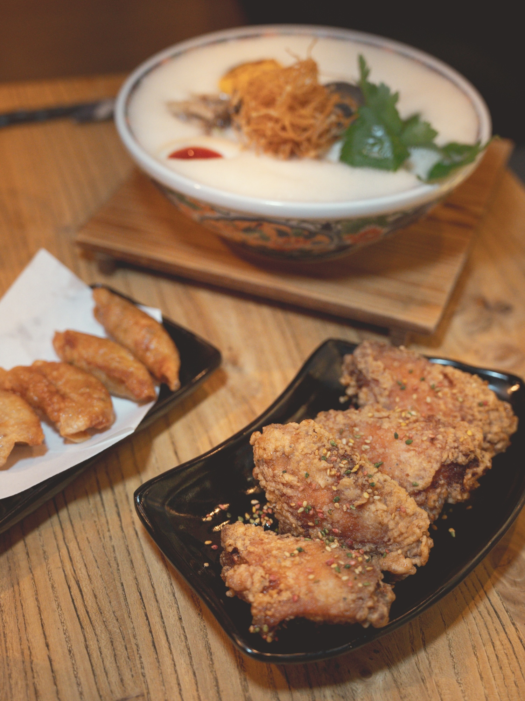
  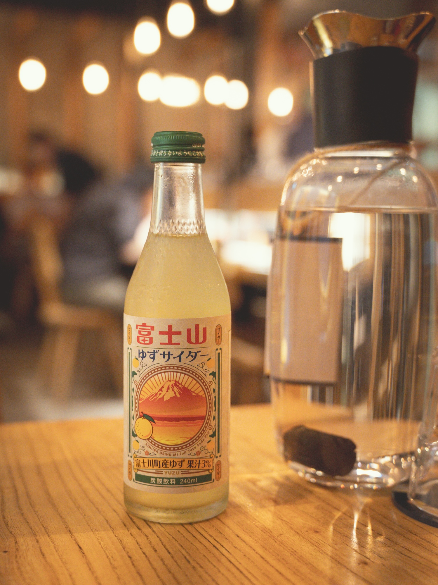

1,200 平方呎的店內空間，以大量原木材質搭配鎢絲吊燈，營造出如家一般溫暖放鬆的氛圍。牆上掛著鮮豔的立體派畫作，在這樣的環境下細味冠軍級職人的手藝，絕對是這個秋天最值得體驗的味覺盛宴。

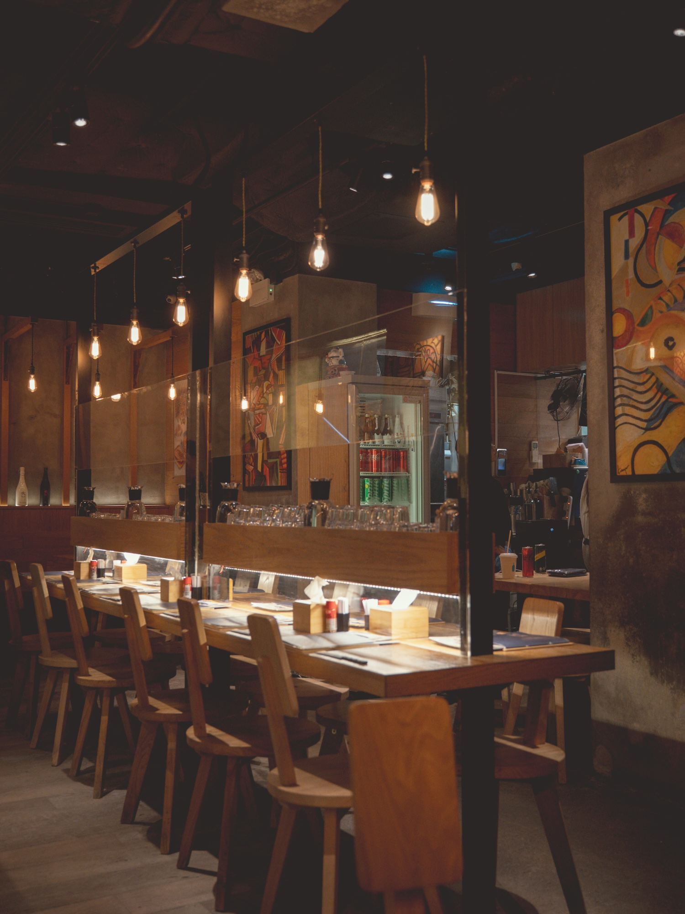

{/* Affiliate 3: 中環高質酒店 Staycation (Agoda) */}
<AffiliateCard 
  type="agoda"
  title="中環極致住宿體驗：The Murray 美利酒店" 
  description="計劃一個完美的週末 Staycation？距離蘭桂坊及中環美食區僅一步之遙的美利酒店 (The Murray)，以其標誌性的拱門設計與奢華空間聞名。在立體派享受完極致拉麵後，回到酒店繼續享受專屬的微醺之夜。" 
  link="https://www.agoda.com/zh-hk/placeholder-the-murray" 
  buttonText="查看 Agoda 最新房價與優惠" 
/>

<RestaurantInfoCard 
  name="立体派 Ramen Cubism"
  address="香港中環威靈頓街 27-29 號元益大廈地庫"
  hours="星期一至日 11:00 - 23:00"
  phone="(852) 2399-0811"
  website="www.ramencubism.com"
  igLink="https://www.instagram.com/ramencubism/"
  igHandle="@ramencubism"
/>